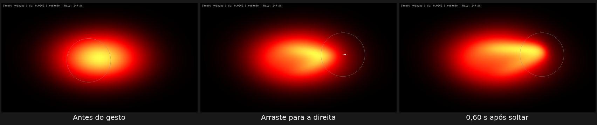
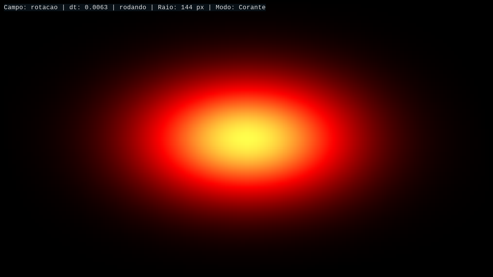
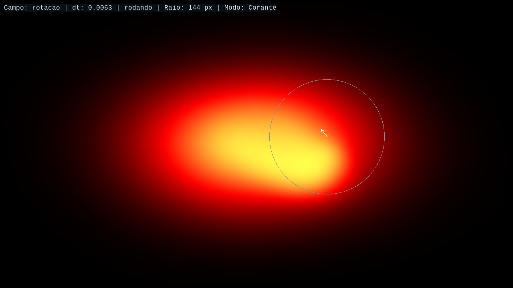
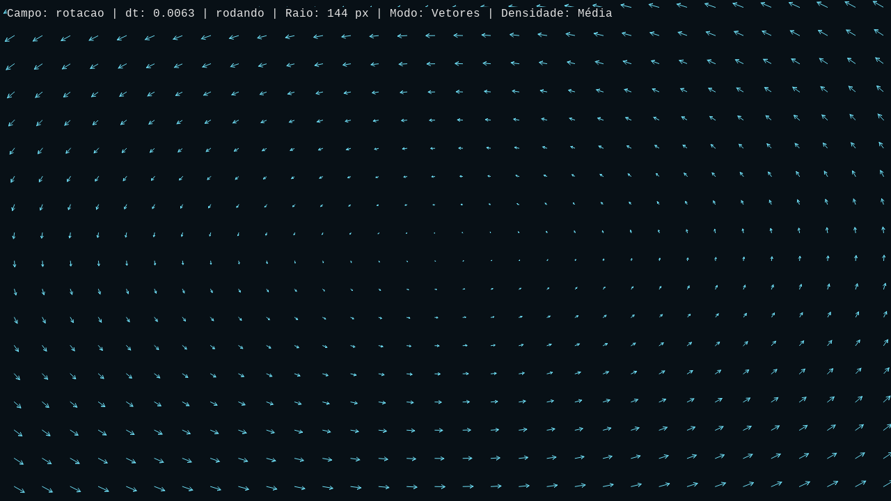
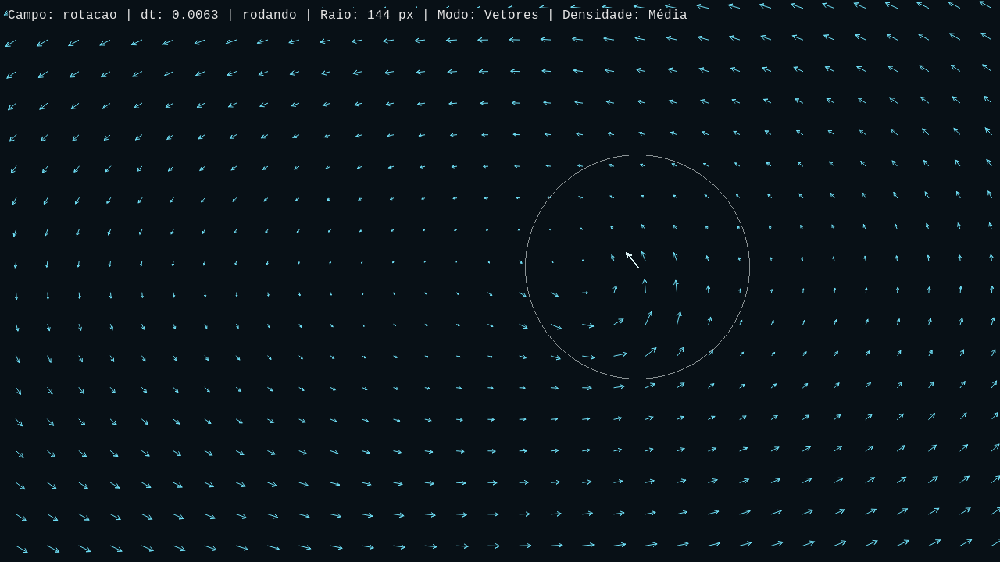
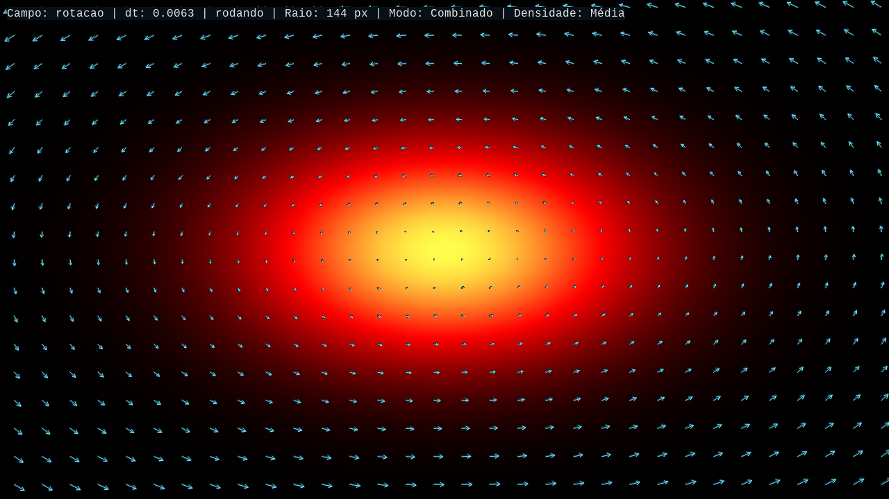
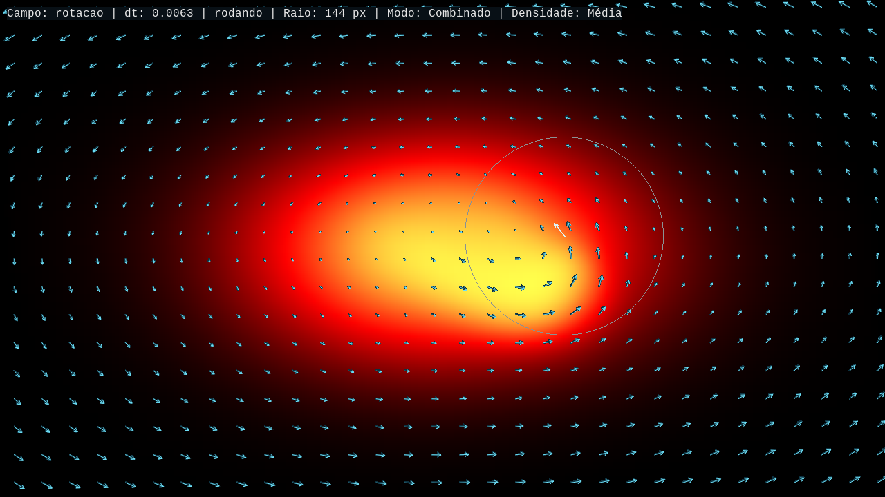

## Primeiros Passos 22/10

- Criei a estrutura do projeto
- Criei o loop principal em `main.py`
- Defini constantes RESOLUCAO, FPS, Dx e Dy (Conversao para notacao fisica do mundo real)
- Criei uma grade para simulacao OBS: indexing='ij' convensao para matriz

### Estrutura do Projeto
```
python-fluids-sim/
    | main.py # LOOP PRINCIPAL de EXECUCAO
    | default.py # Configuracoes padroes e Constantes do projeto
    | calcs.py # FUNCOES RESPONSAVEIS POR CALCULAR TRANSFORMACOES NA SIMULACAO
    | render.py # Funcoes responsaveis por desenhar na tela

```

### Loop principal `main.py`
Nesse arquivo contem a importacao das principais bibliotecas usadas `numpy` e `pygame`

Tambem importa os outros arquivos que fazem parte da estrutura do projeto

Faz as declaracoes basicas para criar uma tela no pygame, definindo resolucao e fps

Cria o loop responsavel por rodar todos os eventos do simulador
	Nele ja conta com a verificacao do botao de fechar

### Constantes 
- `HORIZONTAL` Representa a quantidade de pixels na horizontal
- `VERTICAL`   Representa a quantidade de pixels na vertical
- `RESOLUCAO` Uma tupla que representa a resolucao usando a `HORIZONTAL` e a `VERTICAL` como referencia
- `FPS` Defini a taxa de atualizacoes por segundo
- `Dx e Dy` Definem o espacamento entre as celulas da grade

### Funcao que cria a grade `criar_grade`
Utilizando o meshgrid no numpy, cria uma grid com as coordenadas referentes a `HORIZONTAL` e `VERTICAL`
Permite que essa grid sofra alteracoes sem precisar utilizar o `for` para percorrer cada coordenada
Utilizada a indexacao `ij` adequada para matrizes

### Funcao que desenha a grade
`desenhar_grade(tela, X, Y)`
Funcao que desenha linha com os espacamentos corretos, se baseando na grade criada pela funcao criar_grid

tela = superficie que deve ser desenhada
X = array com a posicao x de cada coordenada do grade
Y = array com a posicao y de cada coordenada do grade

## Interação por forças externas

Com o botão esquerdo pressionado, um gesto sobre a mancha acelera o fluido nas proximidades do cursor. O centro do gesto recebe a maior aceleração. As regiões vizinhas respondem com intensidades diferentes, o que permite alongar o corante. Um gesto circular deposita velocidades tangenciais ao longo da trajetória.



### Do deslocamento na tela à aceleração

Adotamos um domínio de 1 m × 1 m. O nó `[i, j]` representa a posição física $(iD_x,jD_y)$, com $D_x=1/127$ m e $D_y=1/71$ m. Para um pixel $(p_x,p_y)$, a posição em metros é $x=p_x/1279$ e $y=(719-p_y)/719$. Assim, subir na tela aumenta $y$. O primeiro clique apenas estabelece a posição de partida.

A velocidade média do cursor em um segmento é $\mathbf v_m=\Delta\mathbf x/\Delta t_r$, onde $\Delta t_r$ é medido em segundos **reais**. No ponto de aplicação, $\mathbf a=k\mathbf v_m$, com $k=24$ s real/(s simulado)². Essa é a força por unidade de massa. A norma de $\mathbf a$ é limitada a 48 m/(s simulado)², preservando a direção.

O círculo na tela delimita o alcance completo $R$ em pixels. Como o domínio quadrado é exibido em uma janela retangular, o círculo corresponde a uma elipse no domínio físico, com semieixos $R_x=R/1279$ m e $R_y=R/719$ m. Para um centro $(x_m,y_m)$, usamos

$$
q^2=\left(\frac{X-x_m}{R_x}\right)^2+\left(\frac{Y-y_m}{R_y}\right)^2,
\qquad
w=\max\left(0,\frac{e^{-4{,}5q^2}-e^{-4{,}5}}{1-e^{-4{,}5}}\right).
$$

O alcance equivale a três desvios padrão em cada eixo. Subtrair a cauda e normalizar garante $w=1$ no centro e uma transição contínua até zero no círculo. Nas bordas, apenas a parte da gaussiana dentro do domínio contribui. A velocidade local pode ter componente normal à borda. O gesto não reaparece na borda oposta.

O Pygame pode entregar vários segmentos no mesmo frame. Como o loop mede um intervalo real por frame, aproximamos a velocidade escalar em pixels pelo comprimento total do gesto dividido por esse intervalo. A direção vem de cada trecho e é convertida em metros antes do limite de aceleração. Distribuímos $N$ amostras em pontos médios equidistantes ao longo do caminho. A aceleração de cada célula é a média $\overline{\mathbf a}=\sum_{i=1}^{N}w_i\mathbf a_i/N$. Dividir por $N$ evita que o gesto ganhe intensidade quando o sistema entrega mais eventos para a mesma trajetória. A distância-alvo entre amostras é de até $R/6$. O trabalho por frame tem um teto de 96 amostras e 128 segmentos. Acima desses tetos, perde-se detalhe do gesto.

### Acoplamento à advecção e movimento residual

A perturbação $\mathbf p=(u_p,v_p)$ começa em zero. Durante um frame, aproximamos $\overline{\mathbf a}$ como constante e integramos $d\mathbf p/dt=\overline{\mathbf a}-\lambda\mathbf p$ com $\lambda=3{,}2$ (s simulado)⁻¹. Para o intervalo simulado $h=0{,}375\,\Delta t_r$, a solução é

$$
\mathbf p_{n+1}=e^{-\lambda h}\mathbf p_n+
        \frac{1-e^{-\lambda h}}{\lambda}\overline{\mathbf a}.
$$

O fator que multiplica a aceleração tem unidade de tempo. Com o botão solto ou o cursor parado, resta o decaimento exponencial. A velocidade residual cai à metade em cerca de 0,58 s reais. Limitamos sua norma a 2 m/s simulado. O campo horizontal ou rotacional continua definido pelas funções de `calcs.py`.

Para transportar a concentração $c$, mantemos o campo resultante constante nos subpassos do frame e resolvemos

$$
\mathbf u_{\rm total}=\mathbf u_{\rm base}+\mathbf p_{n+1},\qquad
\frac{\partial c}{\partial t}+\mathbf u_{\rm total}\cdot\nabla c=D\nabla^2c.
$$

O método upwind transporta a concentração já deformada. A difusão explícita ($D=0{,}0005$ m²/s simulado) suaviza os gradientes, e o contorno mantém $c=0$ nos quatro lados. Apenas o comando de restauração recupera a gaussiana inicial. A renderização lê a concentração de todos os nós e amplia a superfície com a paleta original.

### Passo temporal e limitações

Advecção e difusão são operadores explícitos aplicados em sequência. Para a advecção, a soma dos números de Courant **na mesma célula** deve ser no máximo um. Para a difusão, os coeficientes do estêncil devem ser não negativos. Por isso, recalculamos os limites com o campo total a cada atualização

$$
r_a=\max_{i,j}\left(\frac{|u_{ij}|}{D_x}+\frac{|v_{ij}|}{D_y}\right),
\qquad r_d=2D\left(D_x^{-2}+D_y^{-2}\right),
\qquad \Delta t_{\max}=\min\left(0{,}012,\frac{0{,}8}{\max(r_a,r_d)}\right).
$$

Se as duas taxas são zero, vale o teto de 0,012 s. O intervalo $h$ é dividido em passos iguais que respeitam esse limite. O HUD exibe o passo efetivamente usado. O máximo é de 12 subpassos por frame. Nos campos base, a maior taxa advectiva é 127 s⁻¹. Pela desigualdade de Cauchy–Schwarz, a perturbação acrescenta no máximo $2\sqrt{D_x^{-2}+D_y^{-2}}$ s⁻¹. Portanto, 10 subpassos já cobrem os 0,01875 s simulados do maior frame aceito na configuração padrão. Um intervalo real acima de 50 ms descarta o gesto daquele frame e avança até esse teto de tempo. Intervalos nulos ou não finitos são ignorados. A estabilidade permite evoluir o corante sem corrigir concentrações negativas após o cálculo.

O modelo prescreve velocidades e simula o transporte de um escalar. A pressão, a advecção da própria velocidade e a restrição de incompressibilidade ficam fora da modelagem. A concentração pode se alongar ou se concentrar espacialmente, e sua integral pode variar com a divergência do campo e com a perda de corante pelas bordas. Isso limita a interpretação como escoamento real ou como solução de Navier–Stokes.

### Controles e execução

| Controle | Efeito |
| --- | --- |
| Botão esquerdo + arraste | Aplica aceleração ao longo do gesto. A seta indica a direção, e seu comprimento representa a intensidade. |
| Scroll | Altera o raio em passos de 12 px, de 36 a 240 px. O valor inicial é 144 px. |
| Espaço | Congela ou retoma o corante e a perturbação. Um novo clique inicia o próximo gesto. |
| R | Restaura o corante e zera a perturbação no campo selecionado. |
| 1 / 2 | Seleciona o campo horizontal / rotacional e zera a perturbação. A distribuição de corante é preservada na troca. |

Ao sair da janela ou perder o foco, o arraste termina. Um novo clique dentro da janela estabelece outra origem para o gesto.

Na raiz do projeto, com NumPy e Pygame instalados, execute `python main.py`. Para reproduzir as verificações no mesmo ambiente Python, use

```sh
python -m unittest discover -s tests -v
python -m tests.ensaio_continuo
```

A suíte usa o driver SDL `dummy` para exercitar o loop e os eventos. O segundo comando mantém o renderizador, o relógio real e um arraste em forma de oito ativos por cinco minutos, verificando os campos em cada atualização.

### Validação e desempenho observados

Em 26/11/2026, os 17 testes automatizados passaram. No ensaio comparativo de um arraste horizontal de um segundo, a maior diferença de concentração entre a mancha arrastada e o controle foi **0,419 a 60 FPS**, na escala inicial de 0 a 1. Repetindo o mesmo gesto a 30, 60 e 120 FPS, a maior diferença ponto a ponto de concentração em relação ao resultado de 120 FPS foi de aproximadamente 0,023. Os campos continuaram finitos e a difusão e a advecção respeitaram os limites de concentração testados.

| Verificação | Evidência |
| --- | --- |
| Simetria, decaimento espacial, componentes, bordas e coordenadas | Testes do peso nos nós da grade, de ida e volta entre nós e pixels e do sinal para movimentos horizontais, verticais e diagonais. |
| Gestos rápidos, lentos, circulares e vários eventos no mesmo frame | Testes de proporcionalidade, saturação, cobertura da trajetória, invariância à subdivisão e direções tangenciais. |
| Clique, cursor parado, soltura, pausa, perda de foco e saída da janela | Testes do loop Pygame, incluindo eventos de saída e reentrada no mesmo frame e retomada com o botão pressionado. |
| Scroll, R, 1 e 2 | Verificação do raio, da matriz restaurada e do campo total após cada controle. |
| Resultado visual | Inspeção de capturas da janela Wayland, incluindo arraste, soltura, círculo, pausa e troca de campo. Em uma sessão SDL offscreen dirigida por comandos, um segundo arraste em sentido inverso mostrou a resposta ao raio reduzido. Os gestos foram enviados como eventos Pygame. A ergonomia com um mouse físico depende de avaliação presencial. |

As medições foram feitas no Fedora 44 com AMD Ryzen 7 5700U, Python 3.14.10, NumPy 2.5.5, pygame-ce 2.5.8 e SDL 2.32.10. A janela tinha 1280 × 720 pixels e a grade, 128 × 72 nós. Cada medição curta contou 300 frames após aquecimento de 31, com o campo rotacional. Os FPS correspondem ao número de frames do loop dividido pelo tempo de relógio.

| Ambiente e condição | Main (`0c73c0c`) | Com interação implementada |
| --- | ---: | ---: |
| Wayland, limitador de 60 FPS, sem gesto | 59,89 FPS | 62,06 FPS |
| Wayland, limitador de 60 FPS, arraste contínuo | — | 61,89 FPS |
| SDL dummy, limitador de 60 FPS, sem gesto | 61,79 FPS | 61,83 FPS |
| SDL dummy, sem limitador, sem gesto | 66,17 FPS | 627,23 FPS |

O relógio do Pygame opera em milissegundos, de modo que o limitador nominal de 60 permite médias ligeiramente superiores. O ensaio sem limitador usa um intervalo físico de referência de 1/60 s real por frame na versão interativa e mede a capacidade de processamento sem o custo do compositor.

No ensaio contínuo com SDL dummy, o arraste percorreu a janela durante **301,039 s reais**, com **18.631 frames** e média de **61,89 FPS**. A maior norma de perturbação observada foi **1,12267 m/s simulado**. A cada frame foram verificadas a finitude das velocidades e da concentração, a faixa de concentração entre 0 e 1 e a norma máxima da perturbação.

## Visualização do campo vetorial de velocidades

Cada nó da grade tem uma velocidade instantânea $\mathbf V(x,y,t)=(u,v)$, em metros por segundo simulado. A componente $u$ descreve o movimento horizontal e $v$ o vertical. A rapidez é $\sqrt{u^2+v^2}$ e o ângulo físico em relação ao eixo $x$ positivo é $\theta=\operatorname{atan2}(v,u)$. Uma seta aponta na direção em que o campo transporta o corante naquele ponto e instante.

As setas mostram $\mathbf V=\mathbf V_{base}+\mathbf V_{perturbado}$. Em cada atualização, o desenho recebe as mesmas matrizes usadas na advecção. A concentração continua evoluindo quando se observa apenas o campo. Em pausa, é possível alternar a representação para examinar a mesma distribuição de corante e de velocidades.

### Como ler as setas

A origem de cada seta corresponde a um nó amostrado. Para desenhar a ponta, projetamos o deslocamento que a velocidade produziria durante um intervalo gráfico fixo $\tau=0{,}024$ s. Na resolução padrão, os extremos do metro físico ficam separados por 1279 pixels na horizontal e 719 na vertical. O deslocamento projetado é

$$
(\Delta p_x,\Delta p_y)=\tau\left(u\,\frac{\mathrm{TAMANHO\_CELULA\_X}}{D_x},
                                    -v\,\frac{\mathrm{TAMANHO\_CELULA\_Y}}{D_y}\right).
$$

Uma componente $v>0$ aponta para cima. As asas da ponta acompanham a direção **já projetada**. Por exemplo, na densidade média, uma velocidade horizontal de 1 m/s produz cerca de 31 pixels e uma vertical de 1 m/s produz cerca de 17 pixels. Para uma mesma direção, dobrar a rapidez dobra o comprimento até o limite de desenho. A diferença entre os eixos decorre da exibição do domínio quadrado em uma janela retangular.

A escala temporal das setas é independente do passo de integração. Para evitar sobreposição, o comprimento satura no menor valor entre 38 pixels e 85% do menor espaçamento entre amostras na tela. Esse limite afeta apenas a representação gráfica. Rapidezes de até 0,02 m/s ficam ocultas. As setas do campo têm cor ciano fixa e recebem contorno escuro sobre o corante. A seta clara junto ao cursor indica a aceleração aplicada pelo gesto.

| Tecla | O que aparece |
| --- | --- |
| F1 | Corante suavizado, modo inicial. |
| F2 | Campo de velocidades sobre fundo escuro. |
| F3 | Setas sobrepostas ao corante. |
| G | Alterna a densidade média → alta → baixa → média. |

A simulação usa sempre os 128 × 72 nós. O desenho escolhe um nó por bloco, próximo ao centro, em cada direção. Os passos 8, 4 e 2 dão até **144, 576 e 2304 setas** nas densidades baixa, média e alta. O HUD mostra a densidade quando os vetores estão visíveis.

### Demonstrações de Cálculo III

1. Pressione **1** e **F2** para ver um campo constante. As setas horizontais têm o mesmo comprimento. Arraste para cima sobre a mancha em **F3** e observe como a componente vertical local inclina as setas e desvia o corante.
2. Pressione **2**, **R** e **F2**. No campo rotacional, o produto escalar da velocidade com o raio relativo ao centro é zero. As setas são tangentes às circunferências físicas, que aparecem como elipses na janela. Compare a rapidez perto e longe do centro.
3. Em **F3**, faça um gesto circular, solte o botão e pause com **Espaço**. Alterne **F1/F2/F3**. Na equação de transporte, $\mathbf V\cdot\nabla c=u\,\partial_x c+v\,\partial_y c$ é a derivada direcional ao longo do versor da velocidade multiplicada pela rapidez (onde a velocidade é não nula). Uma velocidade tangente a uma curva de nível de $c$ dá contribuição advectiva local zero. Uma velocidade que cruza essa curva transporta concentrações diferentes para o ponto. Retome para observar o amortecimento e a evolução da mancha.

### Capturas da aplicação

As colunas mostram o mesmo campo rotacional antes e durante um arraste. Cada par foi obtido pelo loop Pygame, repetindo a trajetória e o relógio nos três modos.

| Modo | Antes do gesto | Durante o gesto |
| --- | --- | --- |
| F1 |  |  |
| F2 |  |  |
| F3 |  |  |

### Testes e desempenho da visualização

Em 27/11/2026, os 17 testes anteriores e os seis testes da visualização passaram com `.venv/bin/python -m unittest discover -s tests -v`. O mesmo gesto, reproduzido com passos idênticos em F1, F2 e F3, gerou matrizes de velocidade e concentração idênticas, inclusive durante a evolução do corante oculto. A suíte verifica a direção das setas, o fator de escala de cada eixo, o limite de comprimento, a troca de densidade em pausa, o arraste, a soltura e a proteção das matrizes de entrada contra escrita durante o desenho.

Médias em FPS no loop completo, com a grade de 128 × 72 e a janela de 1280 × 720. Cada execução usou o campo rotacional e um arraste contínuo por eventos Pygame. Foram 40 frames de aquecimento e 120 medidos por combinação, sem gravar capturas durante a medição. Na execução sem limitador, o relógio forneceu um intervalo fixo de 1/60 s à simulação. Nas demais, o relógio do Pygame controlou o intervalo real. O equipamento usou Fedora 44, Ryzen 7 5700U, Python 3.14.10, NumPy 2.5.5 e pygame-ce 2.5.8.

| Modo | Densidade | SDL dummy sem limitador | SDL dummy, alvo 60 | Janela Wayland, alvo 60 |
| --- | --- | ---: | ---: | ---: |
| Corante antes da feature (`2459b36`) | — | 509,37 | 62,18 | — |
| F1 Corante | — | 459,39 | 62,33 | 62,14 |
| F2 Vetores | Baixa | 562,50 | 62,11 | 61,98 |
| F2 Vetores | Média | 271,45 | 61,94 | 60,70 |
| F2 Vetores | Alta | 94,50 | 62,08 | 62,05 |
| F3 Combinado | Baixa | 312,66 | 62,03 | 62,15 |
| F3 Combinado | Média | 176,47 | 62,03 | 62,17 |
| F3 Combinado | Alta | 67,04 | 61,95 | 52,19 |

Na densidade padrão, os dois modos com vetores atingiram a meta de 60 FPS na janela gráfica. Em F3 com densidade alta, desenhar até 2304 setas com contorno sobre o corante reduziu a média para 52,19 FPS nessa máquina. As médias são de execuções curtas. Os testes verificaram gestos reproduzíveis e as capturas do renderizador. A avaliação com mouse físico permanece pendente.
